# TaoSFV

[](LICENSE) [](https://github.com/Taoism/TaoSFV/actions/workflows/build.yml) 

SFV, MD5, SHA-1, SHA-256, SHA-512, XXH128 and BLAKE3 file verification utility for Windows, with a command-line version.

TaoSFV is made in tribute to ilSFV and hkSFV. It continues [ilSFV](https://github.com/judwhite/ilSFV) by Jud White, ported to .NET 10 with a dark mode. Thanks Jud!

- Multi-language support (currently English, German, Chinese, Russian)
- Supports SFV, MD5, SHA-1, SHA-256 and SHA-512 (md5sum/sha256sum, BSD `--tag` and hkSFV formats), plus XXH128 (`.xxh128`, as `xxhsum -H2` writes it) and BLAKE3 (`.blake3`, as `b3sum` writes it)
- Batch file verification
- Create and verify checksums for files in subdirectories
- Optional cache for quickly re-verifying files
- Ability to run in the background
- Reads BSD style checksum files and other less-known formats
- Option to find renamed files based on checksum files
- Dark mode (Preferences → General → Theme: System default / Light / Dark)
- Checks several files at once on SSDs (one at a time on hard drives and network shares)
- Verify a whole folder tree: File → Verify Folder, drag a folder in, or right-click a folder → TaoSFV → Verify checksum files
- PAR2 recovery sets: open a `.par2` to check its files (damaged, missing, renamed, or with shifted blocks) and repair them from the recovery data, in TaoSFV's own code (no par2cmdline needed); right-click a `.par2` → Check with TaoSFV
- `taosfv-cli` for scripts and scheduled checks

## Screenshots

Dark and light mode (Preferences → General → Theme, or follow Windows). The album is made-up demo data: one track damaged, one missing.

| Dark | Light |
|---|---|
| 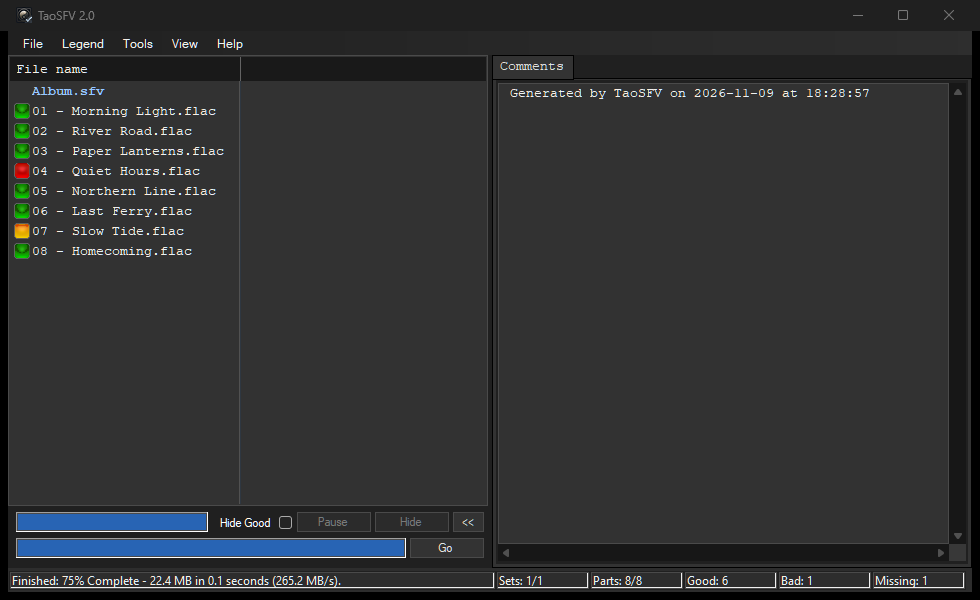 | 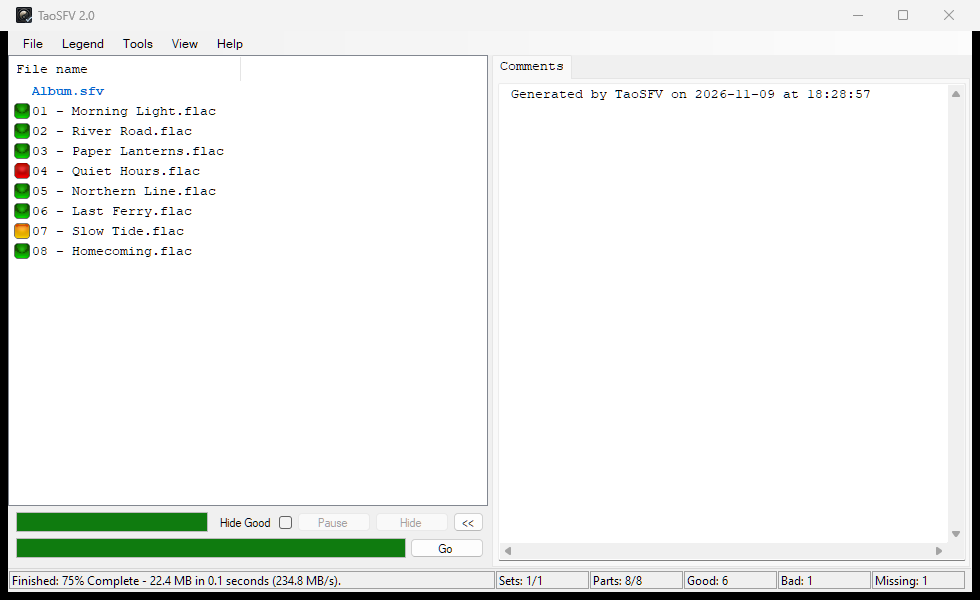 |
| 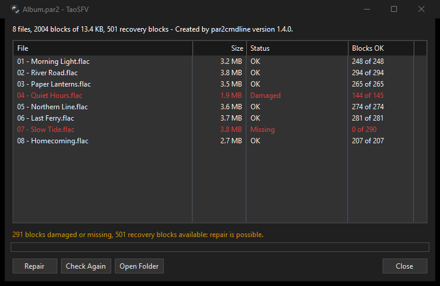 | 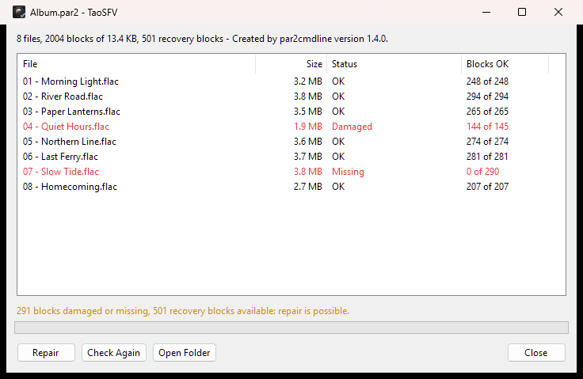 |

<details>
<summary>Every window, menu and Preferences tab</summary>

| | Dark | Light |
|---|---|---|
| Message box | 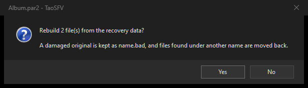 | 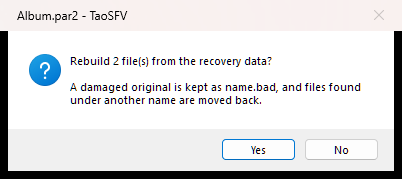 |
| File menu | 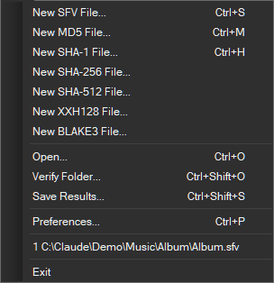 | 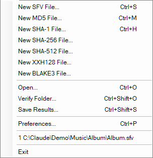 |
| Legend menu | 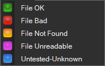 | 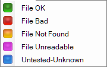 |
| Tools menu | 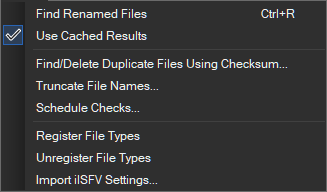 | 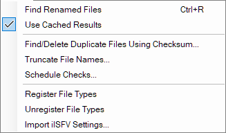 |
| View menu |  | 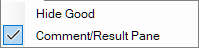 |
| Preferences: General | 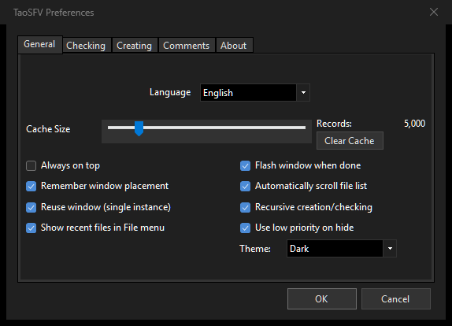 | 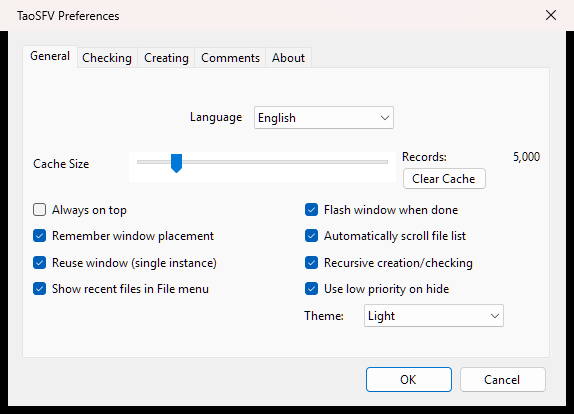 |
| Preferences: Checking | 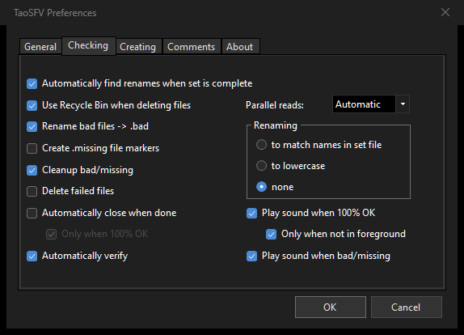 | 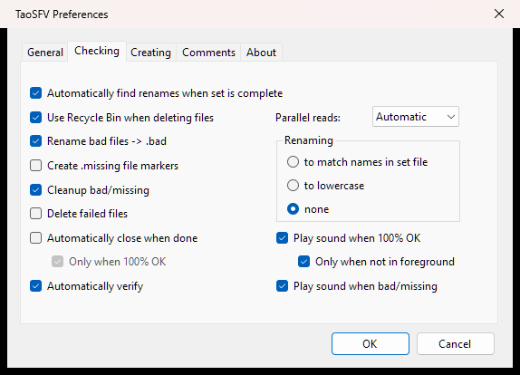 |
| Preferences: Creating | 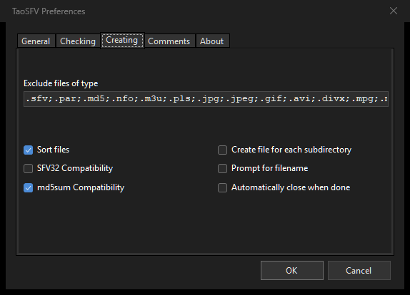 | 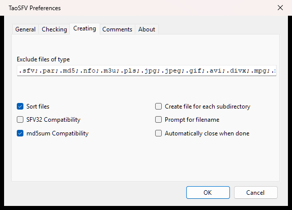 |
| Preferences: Comments | 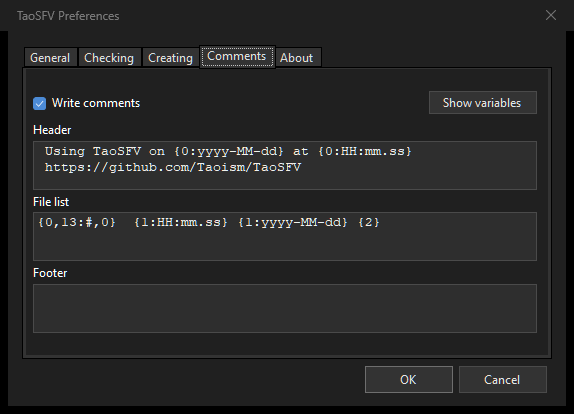 | 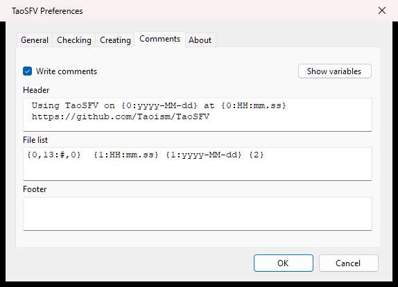 |
| Preferences: About | 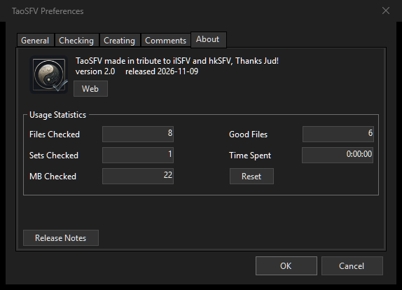 | 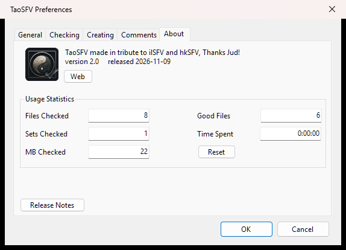 |
| Scheduled Checks | 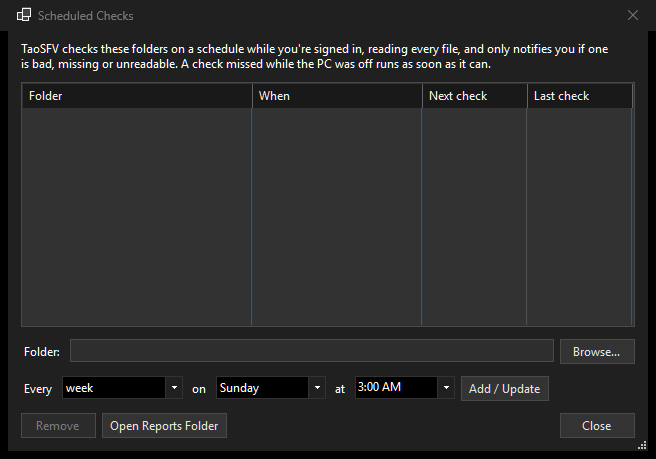 | 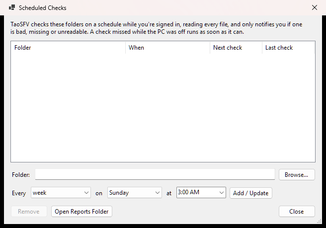 |

</details>

## Download

From [Releases](https://github.com/Taoism/TaoSFV/releases): `TaoSFV-<version>-setup-win-x64.exe` (installer) or `TaoSFV-<version>-win-x64.zip` (unzip and run `TaoSFV.exe`). Both include the .NET runtime; Windows 10 1809 or later, x64. The builds aren't code-signed yet, so SmartScreen may warn on first run.

## Command line

`taosfv-cli.exe` sits next to `TaoSFV.exe`. Output and exit codes follow `md5sum -c`.

```
taosfv-cli verify D:\Music\album.sfv
taosfv-cli verify D:\Music --quiet        # every checksum file under D:\Music
taosfv-cli create sha256 D:\Music\album\album.sha256 D:\Music\album
taosfv-cli verify D:\Downloads\set.par2   # PAR2: damaged, missing or renamed files, and whether repair is possible
taosfv-cli repair D:\Downloads\set.par2   # rebuild them from the recovery data
```

- Exit code 0 when every file is OK, 1 when any is bad, missing or unreadable, 2 for bad arguments or an unreadable checksum file, 130 on Ctrl+C.
- `--quiet` prints only problems and the summary; `--status` prints nothing.
- `--threads N` overrides how many files are read at once.
- Verifying never renames, deletes or creates files.
- `--use-cache` reuses TaoSFV's result cache (`%LOCALAPPDATA%\TaoSFV\cache.db`): a file whose size and modified time haven't changed since it was last checked counts as OK without being read, and new results are added. Faster, but it won't notice damage that left both unchanged. Without the option, every file is read.
- `verify` and `repair` read PAR2 recovery sets (all `.par2` files with the same base name). Repair rebuilds damaged and missing files with TaoSFV's own PAR2 code (no par2cmdline needed), checks each against its MD5 before replacing anything, keeps a damaged original as `name.bad` and moves renamed files back. Its recovery data matches par2cmdline's byte for byte. In TaoSFV itself, open a `.par2` (File → Open, drag it in, or right-click → Check with TaoSFV; after updating, Tools → Register File Types adds that menu).
- `create` writes md5sum-style files with `/` separators and LF line endings, so `md5sum -c` and `sha256sum -c` read them.

## Building

Requires the [.NET 10 SDK](https://dotnet.microsoft.com/download/dotnet/10.0) (the app itself needs the .NET 10 Desktop Runtime).

```
dotnet build TaoSFV\TaoSFV.csproj -c Release
dotnet publish TaoSFV\TaoSFV.csproj -c Release -r win-x64 --self-contained false -o publish
dotnet publish TaoSFV.Cli\TaoSFV.Cli.csproj -c Release -r win-x64 --self-contained false -o publish
dotnet test TaoSFV.Tests
```

Release files (self-contained, so the .NET runtime is included; needs [Inno Setup 6](https://jrsoftware.org/isinfo.php) for the installer):

```
.uild-release.ps1 -Version 2.0.0   # release\TaoSFV-2.0.0-win-x64.zip and TaoSFV-2.0.0-setup-win-x64.exe
```

The installer installs for the current user without an administrator prompt (or for all users), can add `taosfv-cli` to PATH, and removes TaoSFV's file types and Explorer menu when uninstalled.

`TaoSFVLanguage` regenerates `TaoSFV/Localization/*.Generated.cs` after adding strings to `TaoSFV/languages/english.txt`; other language files fall back to English for missing keys.

### Changes from ilSFV 1.11 (.NET Framework 3.5)

- Ported to .NET 10 WinForms (SDK-style project, system-aware high DPI).
- Dark mode via WinForms' built-in color modes, with fixes for the group headers, status bar and tab pages.
- Settings and the checksum cache moved from SQL Server Compact (`*.sdf`) to SQLite (`settings.db`, `cache.db` in `%LOCALAPPDATA%\TaoSFV`). Tools > Import ilSFV Settings (also offered on first start) brings over ilSFV's preferences, usage statistics, recent files and checksum cache; it reads copies, so ilSFV's own files are never changed.
- Stopping a check no longer relies on `Thread.Abort` (unsupported on .NET); MD5/SHA-1 hashing is now thread-safe.
- Checksum files: UTF-8 is detected (with or without a BOM, falling back to Windows-1252), and files are written as UTF-8 when a name doesn't fit Windows-1252, so non-Latin file names work.
- md5sum/sha1sum text-mode lines (`hash  name`, the GNU default) are now read correctly; previously every file showed as missing.
- CRC32 uses the vectorized `System.IO.Hashing.Crc32` with 1 MB reads (about 4x faster); MD5/SHA-1 also read in 1 MB blocks.
- File associations and the Explorer "TaoSFV" menu are registered per user (HKCU), with no administrator prompt; Tools > Unregister File Types removes them.
- Checking runs on background threads, several files at once on SSDs; Pause now really pauses reading.
- SHA-256 and SHA-512 files (`.sha256`, `.sha512`), including in the cache, Explorer menus and File → New.
- XXH128 and BLAKE3 files (`.xxh128`, `.blake3`) for large libraries. They're written as `hash  name` with `/` and no comment lines, so `xxhsum -c` and `b3sum -c` can read them. On a CPU with SHA instructions, SHA-256 is nearly as fast (1 GB from memory: CRC32 0.2 s, XXH128 0.4 s, BLAKE3 0.6 s, SHA-256 0.7 s, MD5 1.7 s); the drive is usually the limit.
- "md5sum compatibility" (Preferences > Creating) now writes `/` separators, LF line endings and `#` comments, so GNU `md5sum -c` / `sha256sum -c` read the files without warnings. SFV files keep the hkSFV layout.
- Paths longer than 260 characters work (the apps are long-path aware; Windows' LongPathsEnabled setting must be on). Moving a failed file to the Recycle Bin still can't handle such paths, so it is left in place.
- Creating checksum files and Find Renamed Files also run in the background (Create reads several files at once on SSDs).
- A file that can't be read (locked, no access) is marked Unreadable (purple) with the reason as a tooltip, and the run carries on instead of stopping.
- The file list is a virtual list, so sets with thousands of files load and update instantly (3,000 files: create 32.7 s -> 0.9 s, verify 8.3 s -> 0.9 s). Sets are shown with header rows.
- Cache writes are batched in transactions.
- Fixed an intermittent startup error ("A generic error occurred in GDI+") that left the main window invisible.
- Links that pointed at the defunct cdtag.com (web, bug reports) now go to the original ilSFV GitHub repository; the update check that used it is removed.
- The default comments header written into new checksum files says "Using TaoSFV" and links to https://github.com/Taoism/TaoSFV. An unchanged ilSFV default header is updated automatically; a custom one is only changed if you agree after importing ilSFV's settings.

## Project Status

Maintained. Issues and Pull Requests will be responded to.

## License

TaoSFV, like ilSFV, is under the MIT license. See the [LICENSE](LICENSE) file for details, and [THIRD-PARTY-NOTICES.txt](THIRD-PARTY-NOTICES.txt) for the libraries it includes.
